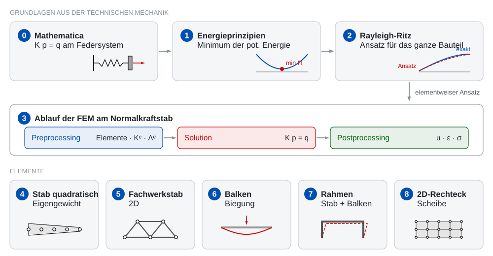

Willkommen! Diese Seite begleitet die Vorlesungen des Moduls. Wir leiten die Finite-Elemente-Methode
Schritt für Schritt aus der Technischen Mechanik her: von den Energieprinzipien über das Verfahren nach
Rayleigh-Ritz bis zu den Elementen Stab, Balken, Rahmen und Scheibe.

- **Vorlesung**: Die Inhalte bauen sich beim Scrollen schrittweise auf. Sie können parallel zum
  Beamer selbst scrollen, vorgreifen oder zurückblättern.
- **Beispiele**: Kleine Modelle zum Ausprobieren im Browser. Ändern Sie Parameter und sehen Sie
  sofort, was passiert.
- **Mathematica**: In Übung und Praktikum rechnen Sie die Aufgaben mit Mathematica. Zu jeder
  Vorlesung gibt es Aufgaben als Mathematica-Datei (.nb) zum Herunterladen.

## Übersicht des Semesters

{width=100% fig-alt="Kursübersicht: Grundlagen (Mathematica, Energieprinzipien, Rayleigh-Ritz), Ablauf der FEM, Elemente"}

| | Thema | Beispiel (Vorlesung) | Übung (Mathematica) | Stand |
|:-:|:--|:--|:--|:-:|
| 0 | [**Einführung: Mathematica und K p = q**](vorlesung/00-einfuehrung.qmd) Kurvendiskussion, Schnittgrößen, DGL, Federsystem | [Federsystem: Steifigkeitsmatrix](beispiele/federsystem/index.html) | [Erste Schritte](mathematica/00-einfuehrung-task.nb){download=""} [Schnittgrößen 7.3](mathematica/00-schnittgroessen-7-3-task.nb){download=""} [DGL konischer Stab](mathematica/00-dgl-stab-konisch-task.nb){download=""} | online |
| 1 | Energieprinzipien Formänderungsenergie, Minimum der potentiellen Energie | | | geplant |
| 2 | Verfahren nach Rayleigh-Ritz Ansatz für das ganze Bauteil, konischer Stab | | | geplant |
| 3 | [**Normalkraftstab: von Ritz zur FEM**](vorlesung/03-stab.qmd) Elementsteifigkeitsmatrix, Inzidenzmatrizen, Ablauf der FEM | [Konischer Stab: Konvergenz](beispiele/stab-konvergenz/index.html) | [Konischer Stab mit 2 Elementen](mathematica/03-stab-konisch-fem-task.nb){download=""} | in Arbeit |
| 4 | Stab: quadratisches Element, innere Lasten höhere Ansatzfunktionen, Eigengewicht | | | geplant |
| 5 | Fachwerkstab (2D) Transformation in globale Koordinaten | | | geplant |
| 6 | Balkenelement Hermite-Ansatz, Biegung | | | geplant |
| 7 | Rahmenelement Stab + Balken | | | geplant |
| 8 | 2D-Rechteckelement Scheibe, ebener Spannungszustand | | | geplant |

: {.striped}

Alle wichtigen Befehle auf einen Blick: **[Mathematica-Spickzettel](spickzettel.qmd)**

## Farben in den Grafiken

**Rot**: Kräfte und FEM-Lösung ·
**Blau**: exakte (analytische) Lösung ·
**Grün**: Bemaßung, Koordinaten, Freiheitsgrade.

::: {#ki-hinweis .ki-hinweis}
**Hinweis zur KI-Nutzung:** Bei der didaktischen Gestaltung dieser Lehrinhalte wurden Methoden der
generativen künstlichen Intelligenz eingesetzt. Der Lehrende hat die Inhalte anschließend geprüft,
angepasst und trägt die Verantwortung für sie.
:::
